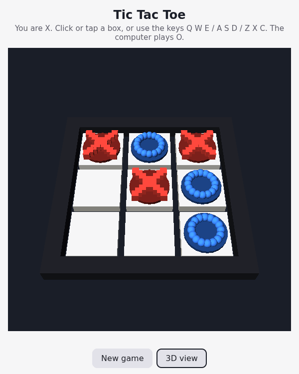
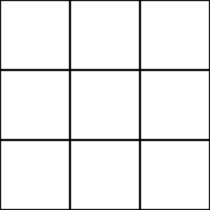
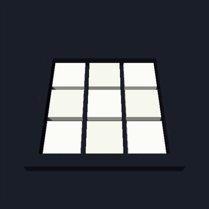
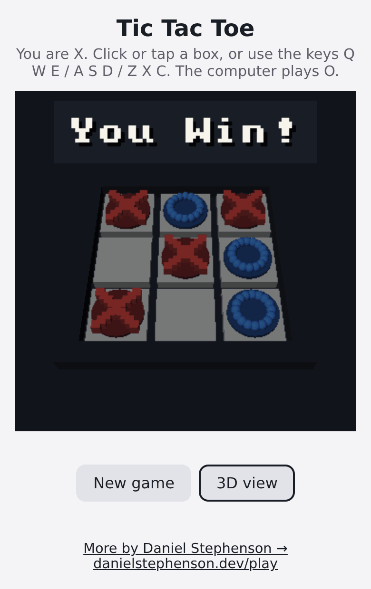
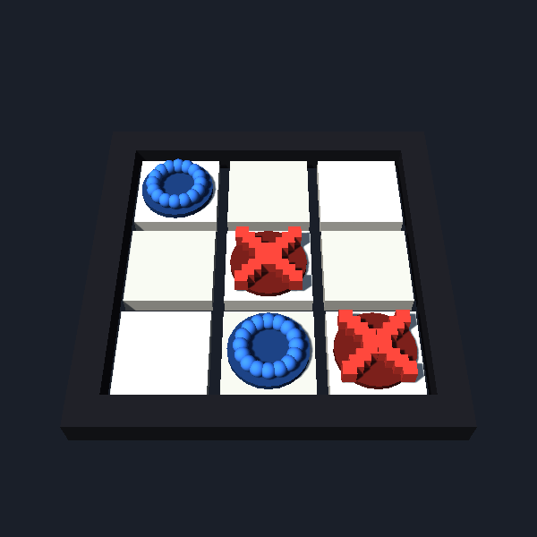

# Tic-Tac-Toe-Using-SDL

Play in your browser: https://danielstephenson.dev/play/tic-tac-toe-using-sdl

*The board in 3D, drawn by [Strata](https://github.com/Preponderous-Software/strata) in the browser build (see "Play in 3D or 2D" below).*

*One real game of the native build, played with the keyboard under a virtual display (see "Screenshots" below).*

To play the game, you need to draw an X in a box each time it is your turn.

To draw an X in a box, tap the corresponding key:

    Q W E
    A S D
    Z X C

Each of these correspond to one of the nine boxes represented once the game is launched.

A box can also be clicked (or tapped, on a touch screen) instead of pressing its key.

A box that already holds an X or an O ignores its key and clicks. After each X
that does not end the game, the computer waits a second and then draws an O in
a randomly chosen empty box.

Three of the same mark in a row, column or diagonal wins; a full board with no
line is a tie.

About a second after the game ends, the whole window shows the result (you
win, the computer wins, or a tie) and stays that way until the window is
closed. There is no new-game key: to play again, start the game again.

## Play in 3D or 2D

- **3D** (the default): https://tic-tac-toe-sdl.play.danielstephenson.dev
- **2D**: https://tic-tac-toe-sdl.play.danielstephenson.dev/?view=2d

`?view=2d` or `?view=3d` in the address picks the board for that visit, and
the **3D view** button under the board switches between them mid-game (the
choice is remembered on that device). With `?view=2d` nothing of the 3D board
is downloaded. On the desktop, the game opens in 3D where Strata's library is
beside it, and `--2d` keeps it to the 2D window:

    ./tictactoe --2d

 

*Left: a real game on the 3D board in a desktop browser, played with clicks
(X against the computer's random O). Right: the end of a game played with taps
on a phone (390 x 844).*

## The board in 3D

Where it can, the game shows the board in 3D, drawn by
[Strata](https://github.com/Preponderous-Software/strata): tiles in a frame,
seen from above and in front, with each X a red cross of blocks and each O a
ring of blue beads. Everything else is the 2D game's: the same keys (Q W E /
A S D / Z X C), the same click or tap on a box (the box under the pointer is
found by casting a ray onto the tiles, and handed to the game as a click on
that box), the same computer, the same rules, and the same end screen, with
the result written over the dimmed board.

- **Desktop.** The game loads Strata's library (`libstrata.so.0.9` on Linux,
  `strata.dll` on Windows) from beside the executable, from the path in
  `STRATA_LIBRARY`, or from the system's library path, and opens its window.
  Where the library is missing or can't run (no graphics driver that can), it
  prints `Playing in 2D: <reason>` and opens the 2D window as before. Start it
  with `--2d` to always play on the 2D board. The release downloads carry the
  library. Behind the 3D window the keys are read by where they are on the
  keyboard (the Q W E / A S D / Z X C block, whatever the layout).
- **Browser.** The page starts in 3D with Strata's
  [grid relay](https://github.com/Preponderous-Software/strata/tree/main/web/kit/grid-relay)
  (about 1 MB more, loaded after the game, and only when the browser has WebGL
  2), over the 2D board, which stays underneath while the 3D board loads and
  whenever it can't run. The **3D view** button switches between them mid-game
  (remembered on that device), and `?view=2d` or `?view=3d` in the address
  picks one for a visit. Taps on a phone play the tile under the finger.

How it is built: [view3d.h](view3d.h) says what the 3D board shows, which box
a press lands on, and how it is sent to the browser's relay (its wire format,
Strata's `web/kit/grid-relay/WIRE.md`); [view3d_strata.h](view3d_strata.h)
draws it with desktop Strata, or sends it to the relay in a browser, and turns
the 3D view's input into the SDL events the 2D window would have produced;
[web/view3d.js](web/view3d.js) is the page's side. Strata's header is in
[third_party/strata](third_party/strata) (MIT, its version in `VERSION`), and
`tools/fetch-strata.sh` fetches and checks that release's library and relay.

Tests:

- `test/view3dTest.cpp` (no SDL, no Strata, no display) picks every box at
  three window shapes (600 x 600, a phone upright and sideways), checks the
  board, the marks and the end screens, and, given the relay's reader
  (`relay.h` from Strata's release), that the browser's relay draws exactly
  what the desktop draws:

      dir=$(tools/fetch-strata.sh web /tmp/strata)
      g++ -std=c++17 -Wall -Wextra -Werror -DVIEW3D_RELAY_H="\"$dir/kit/grid-relay/relay.h\"" -Ithird_party \
        test/view3dTest.cpp -o view3dTest && ./view3dTest

- `test/play3d.py` plays a real game in 3D through Strata's drive channel
  (Strata's `docs/DRIVE.md`), drawn headless, with keys and clicks on tiles,
  and saves the board after each move:

      cp "$(tools/fetch-strata.sh linux /tmp/strata)/lib/libstrata.so.0.9" .
      python3 test/play3d.py . /tmp/play3d

- `test/web3d.cjs` plays the browser build in headless Chromium: it starts in
  3D, clicks, keys and phone taps play the boxes, the 3D view switches off and
  on mid-game, and `?view=2d` never downloads the 3D board.
- `test/view3dShots.cpp` draws the start, a game under way and the three end
  screens headless, at 600 x 600 and phone size.

The Build workflow runs the first two and the Browser build workflow the
third, on every pull request.

## Browser version

The game also runs in a web browser, built with Emscripten
(https://emscripten.org):

    https://tic-tac-toe-sdl.play.danielstephenson.dev
    more games: https://danielstephenson.dev/play

There, boxes are clicked or tapped (the keys work too), and the "New game"
button under the board starts again after a result. The browser version does
not send usage reports.

To build it, install and activate the Emscripten SDK
(https://emscripten.org/docs/getting_started/downloads.html), then run:

    web/build.sh

This writes index.html, index.js, index.wasm and index.data (the six
preloaded PNG files) to web/build/, with the 3D board beside them: Strata's
grid relay (fetched from Strata's release by tools/fetch-strata.sh and checked
against its SHA256SUMS; set STRATA_WEB to an unpacked
strata-<version>-wasm32-emscripten download to build offline) and
web/view3d.js. Serve that directory over HTTP to play it
locally, for example:

    python3 -m http.server --directory web/build 8000

and open http://localhost:8000. The page itself is web/shell.html. The
"Browser build" workflow builds it on every pull request and every push to
master. Pull requests are only built; the game is deployed to
tic-tac-toe-sdl.play.danielstephenson.dev from master pushes (when deployment
is turned on for the repository) or when the workflow is run by hand.

## Downloads

[Releases](https://github.com/Stephenson-Software/Tic-Tac-Toe-Using-SDL/releases)
carry a Linux x64 and a Windows x64 download, built from the tagged commit by
`.github/workflows/release.yml`; each has a `.sha256` beside it. Each download
is the game, the six PNG files, Strata's library for the 3D view (with its
licence and notices), the licence, this README and a
README-download.txt saying how to start it; the Windows one also carries the
SDL2 and SDL2_image DLLs and every other DLL the game loads from MSYS2 (the
image-format libraries, such as libpng and zlib, and the MinGW runtime), about
thirty in all. How a release is made:
[docs/RELEASING.md](docs/RELEASING.md).

## Building from source

You need a C++ compiler, the SDL2 development package, and the SDL2_image
development package with PNG support.

tictactoe.cpp includes <SDL.h> and <SDL_image.h> rather than <SDL2/SDL.h>, so
the SDL2 include directory has to be on the include path. On Linux and macOS,
pkg-config supplies both that path and the libraries:

    g++ -std=c++17 -pthread tictactoe.cpp -o tictactoe $(pkg-config --cflags --libs sdl2 SDL2_image) -ldl

Without pkg-config, the same thing spelled out:

    g++ -std=c++17 -pthread -I/usr/include/SDL2 tictactoe.cpp -o tictactoe -lSDL2 -lSDL2_image -ldl

-pthread is there because the game reports usage on a background thread (see
"Usage reporting" below), and -ldl because the 3D view's library is loaded at
run time (on Windows, leave -ldl out). Strata is not needed to build: put its
library beside the game to play in 3D (see "The board in 3D" above):

    cp "$(tools/fetch-strata.sh linux /tmp/strata)/lib/libstrata.so.0.9" .

## Running

The six PNG files are loaded by relative path, so the game has to be started
from the directory that contains them:

    ./tictactoe

`./tictactoe --2d` keeps to the 2D board.

If an image cannot be loaded (for example, when started from another
directory), or SDL cannot open the window, the game prints the reason on
stderr and exits with status 1 instead of showing a blank window. The Windows
release build has no console (it is linked with -mwindows), so there the
reason is not shown: the game just closes at once.

On Windows, the simplest way to play without building is the Windows x64
download from a release (see "Downloads" above): unzip it and double-click
tictactoe.exe inside.

The tictactoe.exe at the top of this repository does not run on its own. It is
a 32-bit build that needs the PNG files kept next to it, and it also needs DLLs
this repository does not carry: SDL2.dll, SDL2_image.dll and the MinGW runtime
(libgcc_s_dw2-1.dll, libstdc++-6.dll, libmingwex-2.dll). The DLLs in the Windows
x64 download are 64-bit and do not fit it. That binary is prebuilt and is not
rebuilt when tictactoe.cpp changes, so it may not match the current source.

The window is 600x600.

## Usage reporting

The game reports to trace (https://trace.danielstephenson.dev) by default: one
startup event per launch, carrying the program name (Tic-Tac-Toe-Using-SDL),
its version from version.txt, and a random installation ID. Nothing about you,
your machine or the game is sent (the trace server sees the IP address of the
request, as every web server does).

Like the PNG files, version.txt is read from the directory the game is started
in; when it is not there, the version is sent as "unknown". A build can set
the version instead, which then ignores version.txt:

    g++ ... -DTIC_TAC_TOE_VERSION='"0.1.0"' ...

The first run prints one line saying so on stderr and writes a small settings
file, usage-reporting.conf, to $XDG_CONFIG_HOME/Tic-Tac-Toe-Using-SDL/ (by
default ~/.config/Tic-Tac-Toe-Using-SDL/; ~/Library/Application Support/
Tic-Tac-Toe-Using-SDL/ on macOS, %APPDATA%\Tic-Tac-Toe-Using-SDL\ on Windows).
The Windows release build has no console, so there that line is not shown; the
settings file is still written, and README-download.txt in the download says
what is sent and how to turn it off. To turn reporting off:

  - set enabled=false in that file, or
  - set TRACE_USAGE_REPORTING=off or DO_NOT_TRACK=1 in the environment (this
    turns it off for every trace-reporting program, and nothing is printed or
    written).

Every switch fails closed. enabled= keeps reporting on only when it is true,
on, yes or 1 (in any case); false, off, no, 0, a blank value or a typo turn it
off, and so does a settings file that is there but cannot be read (it is never
overwritten). TRACE_USAGE_REPORTING set to anything but blank, true, on, yes or
1 turns reporting off, and so does DO_NOT_TRACK set to anything but blank, 0,
false, off or no. Other spellings count as off too: enable=false,
usage_reporting.enabled=false or usage-reporting=false, and disabled=true, even
next to enabled=true. test/usageReportingTest.cpp checks this.

The installation ID is a random UUID, made the first time reporting is on and
kept in a file named trace-install-id in $XDG_DATA_HOME/tic-tac-toe-using-sdl/
(by default ~/.local/share/tic-tac-toe-using-sdl/; ~/Library/Application
Support/tic-tac-toe-using-sdl/ on macOS, %APPDATA%\tic-tac-toe-using-sdl\ on
Windows). It is not derived from anything about you or your machine; it only
lets trace count installations rather than launches. Delete the file to reset
it. Setting TRACE_INSTALL_ID sends that value instead, and the file is left
alone. Every opt-out above also stops the ID: with reporting off, the file is
never created, read or sent.

The event is sent in the background by the vendored trace-client-cpp header
(trace_client.hpp, https://github.com/Stephenson-Software/trace-client-cpp)
through the system curl; if curl is missing or the machine is offline, nothing
is sent and the game is unaffected. The prebuilt tictactoe.exe predates this
and does not report until it is rebuilt.

TIC_TAC_TOE_USING_SDL_USAGE_REPORTING_ENDPOINT points reporting at another
server, e.g. a local one while testing. A line endpoint=<url> in
usage-reporting.conf does the same; the environment variable wins when both
are set.

Details: https://danielstephenson.dev/usage-reporting

## Screenshots

`docs/images/gameplay.gif` was recorded from the native build run under Xvfb,
with keys sent by `xdotool` and frames grabbed by ImageMagick. Usage reporting
is turned off for the recording. To record a new one (the computer's moves are
random, so every run is a different game):

    bash docs/capture.sh

It needs `Xvfb`, `xdotool` and ImageMagick in addition to the build
dependencies above.

The 3D pictures (`docs/images/3d-hero.png`, `3d-play.gif` and `3d-phone.png`)
were taken from the browser build (`web/build.sh`) in headless Chromium with
Playwright, at a desktop size (760 x 900) and a phone's (390 x 844), while a
game was played on the 3D board with clicks and taps; the GIF was cut from that
run's screen recording.

## Note
I used the SDL tutorial located at the page below as a jumping off point for this.
http://lazyfoo.net/tutorials/SDL/index.php#Hello%20SDL
